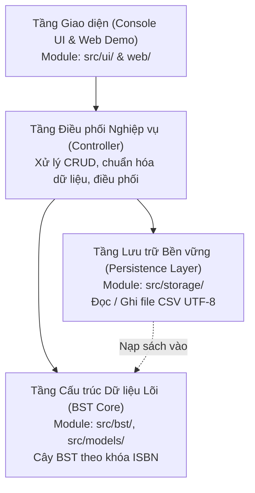

# Tài liệu Kiến trúc Hệ thống — Đề tài 04: Quản lý danh mục sách thư viện

- **Người phụ trách kiến trúc:** Trần Ninh Thuận (M1 - Trưởng nhóm)
- **Học phần:** Cấu trúc dữ liệu và Giải thuật (C++)
- **Phiên bản:** 1.0 (Ban hành ngày 25/10/2026)

---

## 1. Tổng quan kiến trúc

Hệ thống Quản lý danh mục sách thư viện được thiết kế theo mô hình phân tầng hướng module (Modular Layered Architecture). Mỗi tầng có trách nhiệm độc lập rõ ràng, tuân thủ nguyên lý *Separation of Concerns (SoC)*:



---

## 2. Phân rã các Module và Trách nhiệm

| Module | Thư mục mã nguồn | Thành viên phụ trách | Trách nhiệm chính |
|---|---|---|---|
| **Entry Point** | `src/main.cpp` | Trần Ninh Thuận (M1) | Điểm khởi nhập, cấu hình console UTF-8, khởi động vòng lặp chương trình. |
| **Model** | `src/models/Book.h`, `.cpp` | Phan Thế Hiệp (M2) | Thực thể Sách: ISBN, Tên, Tác giả, NXB, Năm, Thể loại; các toán tử so sánh `<, >, ==`. |
| **BST Core** | `src/bst/BST.h`, `BSTNode.h`, `.cpp` | Phan Thế Hiệp (M2) | Quản lý cây BST theo ISBN: `insert`, `search`, `erase` (đủ 3 trường hợp), duyệt `LNR/NLR/LRN`, giải phóng bộ nhớ. |
| **Console UI** | `src/ui/Menu.h`, `.cpp` | Huỳnh Văn Lĩnh (M3) | Hiển thị menu bảng điều khiển, bắt nhập liệu, giao diện tìm kiếm, chọn bản ghi xóa khi trùng tác giả/tên. |
| **Storage** | `src/storage/FileStorage.h`, `.cpp` | Lê Cường Bảo (M4) | Đọc và ghi tệp CSV chuẩn UTF-8, kiểm tra hợp lệ bản ghi, khôi phục trạng thái cây từ file. |
| **QA / Tests** | `tests/cases/`, `tests/results/` | Phạm Đức Cường (M5) | Xây dựng bộ ca kiểm thử, đo đạc thời gian thực thi $O(h)$ và đánh giá độ phức tạp thuật toán. |

---

## 3. Quyết định Thiết kế & Quản lý Bộ nhớ (Memory Ownership)

### 3.1. Quyền sở hữu và Vòng đời của Cây BST
- **BST sở hữu toàn bộ các `BSTNode*`:** Cây nhị phân tìm kiếm chịu trách nhiệm cấp phát động (`new BSTNode`) khi chèn sách và giải phóng (`delete`) khi xóa sách.
- **Hủy cây an toàn (`clear()` / Destructor):** Khi kết thúc phiên làm việc, destructor `~BST()` sẽ duyệt hậu thứ tự (Post-order / LRN) để giải phóng toàn bộ các node, ngăn ngừa triệt để lỗi rò rỉ bộ nhớ (Memory Leak).
- **Phòng chống Double-free:** Cấm phép gán copy hoặc cài đặt sao chép sâu (Deep Copy) để đảm bảo hai con trỏ không bao giờ cùng trỏ vào một vùng nhớ node.

### 3.2. Quy tắc định danh và tra cứu
- **Khóa chính duy nhất:** Khóa của BST là `ISBN` (đã chuẩn hóa, loại bỏ dấu gạch ngang).
- **Tra cứu ISBN:** Thao tác tìm kiếm có độ phức tạp thời gian trung bình $O(\log N)$ và trường hợp xấu nhất là $O(h) = O(N)$.
- **Tra cứu Tên sách / Tác giả:** Do tên và tác giả có thể trùng lặp, hệ thống sử dụng thuật toán duyệt toàn bộ cây ($O(N)$) để gom danh sách kết quả. Nếu tìm thấy nhiều sách trùng tên, hệ thống hiển thị bảng danh sách và yêu cầu người dùng xác nhận mã ISBN cần thao tác.

---

## 4. Đặc tả Định dạng Tệp Dữ liệu (CSV Schema)

Tệp lưu trữ danh mục sách định dạng UTF-8, có dòng tiêu đề:
```csv
ISBN,Title,Author,Publisher,Year,Genre
9780132350884,Clean Code,Robert C. Martin,Prentice Hall,2008,Software Engineering
9780201633610,Design Patterns,Erich Gamma,Addison-Wesley,1994,Software Engineering
```
- Phân cách bởi dấu phẩy `,`. Nếu trường dữ liệu chứa dấu phẩy, giá trị sẽ được bao bọc trong dấu ngoặc kép `"..."`.
- Kiểm tra hợp lệ: Bỏ qua dòng trống, kiểm tra định dạng ISBN hợp lệ, năm xuất bản là số nguyên dương $> 0$.
