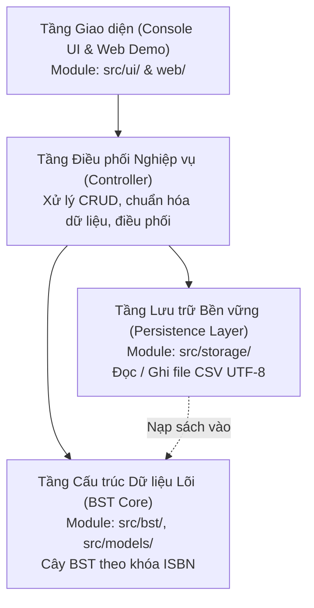

# Tài liệu Kiến trúc Hệ thống — Đề tài 04: Quản lý danh mục sách thư viện

- **Người phụ trách kiến trúc:** Trần Ninh Thuận (M1 - Trưởng nhóm)
- **Học phần:** Cấu trúc dữ liệu và Giải thuật (C++)
- **Phiên bản:** 1.0 (Ban hành ngày 25/10/2026)

---

## 1. Tổng quan kiến trúc

Hệ thống Quản lý danh mục sách thư viện được thiết kế theo mô hình phân tầng hướng module (Modular Layered Architecture). Mỗi tầng có trách nhiệm độc lập rõ ràng, tuân thủ nguyên lý *Separation of Concerns (SoC)*:



---

## 2. Phân rã các Module và Trách nhiệm

| Module | Thư mục mã nguồn | Thành viên phụ trách | Trách nhiệm chính |
|---|---|---|---|
| **Entry Point** | `src/main.cpp` | Khung ban đầu: Trần Ninh Thuận (M1); tích hợp ứng dụng: Codex | Cấu hình console UTF-8, nạp CSV, tạo BST và gọi menu. |
| **Model** | `src/models/Book.h`, `.cpp` | Phần model ban đầu: M2; chuẩn hóa/kiểm tra ISBN: tích hợp | Thực thể sách, chuẩn hóa ISBN-10/13 và kiểm tra checksum cùng trường bắt buộc. |
| **BST Core** | `src/bst/BST.h`, `BSTNode.h`, `.cpp` | Phần BST ban đầu: M2; tích hợp ứng dụng: Codex | Cây BST theo ISBN với `insert`, `search`, `deleteBook`, cập nhật, duyệt `LNR/NLR/LRN` và giải phóng cây. |
| **Console UI** | `src/ui/Menu.h`, `.cpp` | Bổ sung ở commit tích hợp | Menu thêm, sửa, xóa, tìm ISBN/tên/tác giả, xem thứ tự duyệt và lưu dữ liệu. |
| **Storage** | `src/storage/FileStorage.h`, `.cpp` | Bổ sung ở commit tích hợp | Đọc/ghi CSV UTF-8, xử lý trường có dấu phẩy/ngoặc kép, báo dòng lỗi và thay tệp an toàn. |
| **QA / Tests** | `tests/cases/`, `tests/results/`, `tests/` | Kế hoạch: Phạm Đức Cường (M5); test BST: M2; test CSV: tích hợp | Ca kiểm thử chức năng cho BST và CSV; kết quả thực chạy được ghi riêng trong `tests/results/`. Chưa có số đo hiệu năng được xác nhận. |

---

## 3. Quyết định Thiết kế & Quản lý Bộ nhớ (Memory Ownership)

### 3.1. Quyền sở hữu và Vòng đời của Cây BST
- **BST sở hữu toàn bộ các `BSTNode*`:** Cây nhị phân tìm kiếm chịu trách nhiệm cấp phát động (`new BSTNode`) khi chèn sách và giải phóng (`delete`) khi xóa sách.
- **Hủy cây an toàn:** `destroyTree()` duyệt hậu thứ tự (Post-order / LRN) để giải phóng các node khi chương trình kết thúc.
- **Phòng chống Double-free:** Chỉ gọi `destroyTree()` một lần cho mỗi gốc; sau khi giải phóng không dùng lại các con trỏ node.

### 3.2. Quy tắc định danh và tra cứu
- **Khóa chính duy nhất:** ISBN được bỏ dấu cách/dấu gạch ngang, đổi chữ `x` thành `X`; ISBN-10 hợp lệ được quy đổi thành ISBN-13 tương ứng trước khi lưu làm khóa.
- **Tra cứu ISBN:** Thao tác tìm kiếm có độ phức tạp thời gian trung bình $O(\log N)$ và trường hợp xấu nhất là $O(h) = O(N)$.
- **Tra cứu Tên sách / Tác giả:** Do tên và tác giả có thể trùng lặp, hệ thống sử dụng thuật toán duyệt toàn bộ cây ($O(N)$) để gom danh sách kết quả. Nếu tìm thấy nhiều sách trùng tên, hệ thống hiển thị bảng danh sách và yêu cầu người dùng xác nhận mã ISBN cần thao tác.

---

## 4. Đặc tả Định dạng Tệp Dữ liệu (CSV Schema)

Tệp lưu trữ danh mục sách định dạng UTF-8, có dòng tiêu đề:
```csv
ISBN,Title,Author,Publisher,Year,Genre
9780132350884,Clean Code,Robert C. Martin,Prentice Hall,2008,Software Engineering
9780201633610,Design Patterns,Erich Gamma,Addison-Wesley,1994,Software Engineering
```
- Phân cách bởi dấu phẩy `,`. Nếu trường dữ liệu chứa dấu phẩy, giá trị sẽ được bao bọc trong dấu ngoặc kép `"..."`.
- Kiểm tra hợp lệ: Bỏ qua dòng trống, kiểm tra định dạng ISBN hợp lệ, năm xuất bản là số nguyên dương $> 0$.
