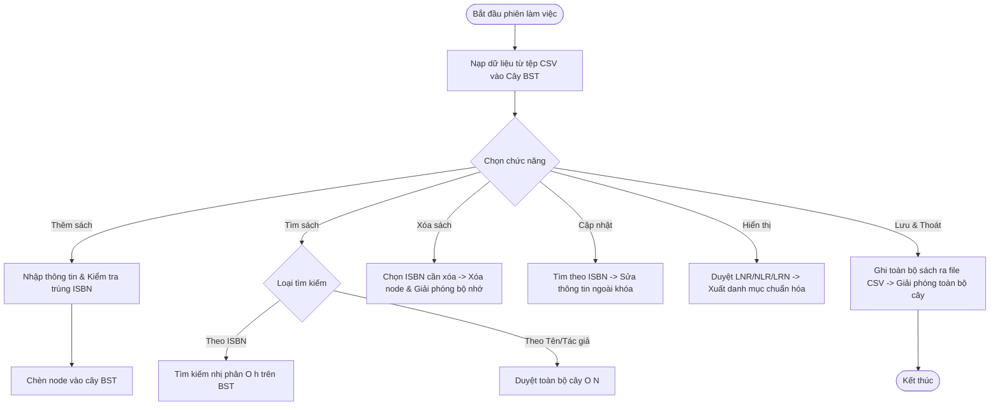
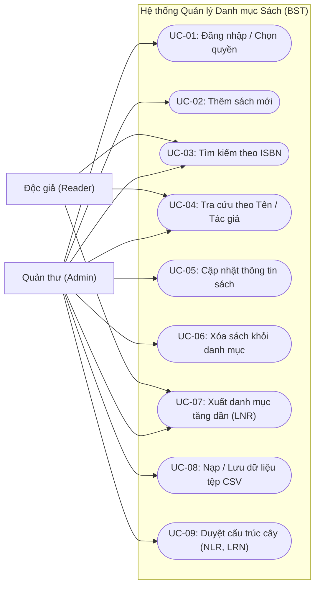

# BÁO CÁO BÀI TẬP LỚN CẤU TRÚC DỮ LIỆU & GIẢI THUẬT
## ĐỀ TÀI 04: QUẢN LÝ DANH MỤC SÁCH THƯ VIỆN BẰNG CÂY NHỊ PHÂN TÌM KIẾM (BST)

---

# CHƯƠNG 1: TỔNG QUAN ĐỀ TÀI VÀ PHÂN TÍCH YÊU CẦU

- **Thành viên phụ trách biên soạn:** Trần Ninh Thuận (M1 - Trưởng nhóm)
- **Học phần:** Cấu trúc dữ liệu và Giải thuật (C++)
- **Mục tiêu số trang quy đổi:** ~7 trang báo cáo chuẩn học thuật

---

## 1.1. Đặt vấn đề và Tính cấp thiết của đề tài

Trong kỷ nguyên chuyển đổi số và bùng nổ tri thức số, thư viện trường đại học và các tổ chức nghiên cứu đóng vai trò là huyết mạch cung cấp tư liệu và tài liệu học tập. Với số lượng hàng chục nghìn đến hàng trăm nghìn đầu sách được cập nhật liên tục, công tác quản lý biên mục truyền thống (bằng sổ tay hoặc bảng tính tĩnh) bộc lộ rất nhiều bất cập: tốc độ tra cứu chậm chạp, dễ xảy ra sai sót khi cập nhật thông tin và khó khăn trong việc tổ chức hiển thị danh mục theo một thứ tự chuẩn hóa.

Đối với các hệ thống quản lý dữ liệu, việc lựa chọn cấu trúc dữ liệu lưu trữ trong bộ nhớ đóng vai trò quyết định tới hiệu năng tổng thể của ứng dụng:
- Nếu lưu trữ danh mục bằng **mảng động (Dynamic Array)** hoặc **danh sách liên kết (Linked List)**:
  - Thao tác tìm kiếm tuần tự đòi hỏi độ phức tạp thời gian là $O(N)$. Dù mảng có thể sắp xếp để tìm nhị phân trong $O(\log N)$, thao tác chèn (insert) hoặc xóa (delete) sách lại tiêu tốn chi phí dịch chuyển phần tử lên tới $O(N)$.
  - Danh sách liên kết giải quyết được việc cấp phát động nhưng thao tác tìm kiếm bắt buộc phải duyệt tuần tự $O(N)$.
- **Cây nhị phân tìm kiếm (Binary Search Tree - BST)** là cấu trúc dữ liệu phân cấp tối ưu:
  - Cho phép quản lý các phần tử có thứ tự dựa trên một trường khóa (Key) bất biến duy nhất.
  - Cung cấp tốc độ tìm kiếm, chèn mới và xóa bỏ bản ghi với chi phí trung bình là $O(\log N)$ (tương đương chiều cao $O(h)$ của cây cân đối).
  - Khả năng xuất danh mục toàn bộ sách theo thứ tự khóa tăng dần một cách tự nhiên thông qua phép duyệt giữa (In-order Traversal - LNR) với chi phí thời gian tuyến tính tối ưu $O(N)$ mà không cần tốn chi phí chạy các thuật toán sắp xếp rời rạc như QuickSort hay MergeSort.

Đề tài **"Quản lý danh mục sách thư viện bằng cây nhị phân tìm kiếm"** được xây dựng nhằm ứng dụng sâu sắc lý thuyết cấu trúc dữ liệu cây nhị phân vào giải quyết bài toán thực tế, đồng thời rèn luyện kỹ năng thiết kế kiến trúc phần mềm hướng module, quản trị bộ nhớ động an toàn bằng C++ và quy trình cộng tác phân tán chuyên nghiệp trên nền tảng Git/Jira.

---

## 1.2. Khảo sát Hiện trạng và Quy trình Nghiệp vụ Thư viện

Qua khảo sát thực tế quy trình vận hành tại các trung tâm thông tin thư viện, nhóm đã chuẩn hóa các luồng nghiệp vụ cốt lõi sau:

### 1.2.1. Quy trình tiếp nhận và biên mục sách mới
1. Cán bộ thư viện nhận sách mới kèm mã chuẩn quốc tế **ISBN** (International Standard Book Number).
2. Hệ thống kiểm tra tính hợp lệ của ISBN và đối chiếu với cây BST hiện tại:
   - Nếu ISBN đã tồn tại trên cây: Báo lỗi trùng lặp và từ chối thêm mới (đảm bảo tính toàn vẹn của khóa chính).
   - Nếu ISBN chưa tồn tại: Thu thập đầy đủ các trường thuộc tính (Tên sách, Tác giả, Nhà xuất bản, Năm xuất bản, Thể loại), tạo đối tượng `Book`, cấp phát động một node mới (`BSTNode`) và gắn vào vị trí hợp lệ trên cây BST theo quy tắc tìm kiếm nhị phân.

### 1.2.2. Quy trình tra cứu và phục vụ độc giả
Hệ thống cung cấp hai cơ chế tra cứu nhằm đáp ứng linh hoạt các tình huống nghiệp vụ:
1. **Tra cứu chính xác theo mã ISBN:**
   - Sử dụng trực tiếp thuật toán tìm kiếm trên cây BST.
   - Tại mỗi node, so sánh mã ISBN truy vấn với ISBN của node hiện tại: rẽ trái nếu nhỏ hơn, rẽ phải nếu lớn hơn, dừng lại khi tìm thấy hoặc gặp node lá (không tìm thấy).
   - Độ phức tạp thời gian đạt $O(h)$ (trung bình $O(\log N)$).
2. **Tra cứu theo Tên sách hoặc Tác giả:**
   - Trong thực tế, độc giả thường chỉ nhớ nhan đề hoặc tác giả chứ không nhớ mã ISBN. Do tên sách và tác giả có thể trùng lặp và không phải là khóa của cây BST, hệ thống thực hiện duyệt toàn bộ cây ($O(N)$) để trích xuất tất cả các sách thỏa mãn chuỗi tìm kiếm (không phân biệt chữ hoa/thường).
   - Nếu có nhiều sách trùng thông tin, hệ thống liệt kê danh sách kết quả kèm ISBN tương ứng để người dùng lựa chọn chính xác đầu sách quan tâm.

### 1.2.3. Quy trình cập nhật và thanh lý sách (Xóa sách)
- **Cập nhật thông tin:** Cho phép chỉnh sửa tên sách, tác giả, nhà xuất bản, năm xuất bản và thể loại. Khóa ISBN là bất biến (không cho phép sửa trực tiếp để tránh phá vỡ cấu trúc cây; nếu muốn đổi ISBN bắt buộc phải xóa sách cũ và thêm sách mới).
- **Thanh lý (Xóa khỏi danh mục):** Xóa sách là nghiệp vụ phức tạp nhất trên cây BST, đòi hỏi xử lý triệt để 3 trường hợp cấu trúc cây:
  - *Trường hợp 1 (Node lá):* Node cần xóa không có con. Thao tác: Ngắt liên kết từ node cha và giải phóng con trỏ (`delete`).
  - *Trường hợp 2 (Node có đúng 1 con):* Node cần xóa có một con trái hoặc một con phải. Thao tác: Nối trực tiếp node con đó với node cha của node bị xóa, sau đó thu hồi vùng nhớ.
  - *Trường hợp 3 (Node có đủ 2 con):* Node cần xóa có cả cây con trái và cây con phải. Thao tác: Tìm node thế mạng (hoặc là node lớn nhất bên cây con trái - In-order Predecessor, hoặc là node nhỏ nhất bên cây con phải - In-order Successor), sao chép dữ liệu của node thế mạng sang node hiện tại, sau đó xóa đệ quy node thế mạng ban đầu.
  - Sau khi xóa, con trỏ được giải phóng ngay lập tức, không để lại vùng nhớ rác (Dangling Pointer / Memory Leak).

### 1.2.4. Quy trình lưu trữ và phục hồi dữ liệu (Persistence)
- Khi khởi động ứng dụng, toàn bộ danh mục từ tệp tin (`data/sample/books.csv`) được nạp tự động vào cây BST trong RAM.
- Trong suốt phiên làm việc, mọi thao tác thêm/sửa/xóa diễn ra tức thì trên cấu trúc dữ liệu BST.
- Khi người dùng chọn chức năng lưu hoặc thoát chương trình, hệ thống duyệt cây theo thứ tự LNR và tuần tự hóa (serialize) dữ liệu ra tệp CSV chuẩn UTF-8, đảm bảo dữ liệu không bị thất thoát giữa các phiên làm việc.

---

## 1.3. Phân tích Yêu cầu Hệ thống

### 1.3.1. Yêu cầu Chức năng (Functional Requirements - FR)

| Mã yêu cầu | Tên chức năng | Mô tả chi tiết | Độ ưu tiên | Phụ trách chính |
|---|---|---|:---:|---|
| **FR-01** | Khởi tạo & Cấu hình | Khởi tạo cấu trúc cây BST rỗng, cấu hình môi trường console hỗ trợ tiếng Việt có dấu (UTF-8). | Bắt buộc | M1 |
| **FR-02** | Thêm sách mới | Nhập thông tin sách, kiểm tra hợp lệ, không cho phép trùng ISBN, cấp phát động node mới và chèn vào BST. | Bắt buộc | M2, M3 |
| **FR-03** | Tìm kiếm theo ISBN | Tìm kiếm nhị phân theo mã ISBN duy nhất, trả về thông tin chi tiết đầu sách nếu tìm thấy. | Bắt buộc | M2, M3 |
| **FR-04** | Tìm kiếm theo Tên/Tác giả | Duyệt cây gom các bản ghi khớp chuỗi con, hiển thị danh sách để người dùng tra cứu hoặc chọn xử lý. | Bắt buộc | M3 |
| **FR-05** | Cập nhật sách | Chỉnh sửa các trường thông tin mô tả của sách theo ISBN xác định. | Bắt buộc | M3 |
| **FR-06** | Xóa sách khỏi cây | Xóa node tương ứng với ISBN; xử lý chuẩn 3 trường hợp node lá, 1 con, 2 con và giải phóng bộ nhớ. | Bắt buộc | M2, M3 |
| **FR-07** | Hiển thị danh mục (LNR) | Duyệt giữa (In-order), xuất toàn bộ danh mục sách sắp xếp tăng dần theo mã ISBN dưới dạng bảng rõ ràng. | Bắt buộc | M2, M3 |
| **FR-08** | Duyệt cây NLR và LRN | Duyệt tiền thứ tự (NLR) và hậu thứ tự (LRN) nhằm phục vụ trực quan hóa cấu trúc phân cấp cây và giải phóng bộ nhớ. | Nâng cao | M2 |
| **FR-09** | Nạp dữ liệu từ tệp | Đọc tệp CSV khi khởi động, kiểm tra định dạng dòng, bỏ qua dòng lỗi và đưa sách vào cây. | Bắt buộc | M4 |
| **FR-10** | Lưu dữ liệu ra tệp | Ghi toàn bộ dữ liệu hiện thời trên cây ra tệp CSV lưu trữ lâu dài. | Bắt buộc | M4 |
| **FR-11** | Giải phóng bộ nhớ toàn diện | Duyệt hậu thứ tự (Post-order) để thu hồi toàn bộ vùng nhớ cấp phát động khi đóng chương trình (`clear()`). | Bắt buộc | M2 |
| **FR-12** | Giao diện mô phỏng Web Demo | Giao diện Web trực quan minh họa luồng độc giả gửi yêu cầu mượn sách, giữ chỗ đầu sách và Admin duyệt phiếu mượn. | Nâng cao | M3, Cả nhóm |

### 1.3.2. Yêu cầu Phi chức năng (Non-Functional Requirements - NFR)

1. **Hiệu năng và Tối ưu hóa thuật toán (NFR-01):**
   - Thao tác tìm kiếm, chèn, xóa trên cây BST phải đạt thời gian thực thi trung bình $O(\log N)$ với $N$ là số lượng đầu sách.
   - Phép duyệt LNR xuất danh mục tăng dần phải đạt độ phức tạp thời gian tuyến tính $O(N)$ và không gian $O(h)$.
2. **An toàn bộ nhớ và Quản lý tài nguyên (NFR-02):**
   - Tuân thủ nguyên tắc RAII (Resource Acquisition Is Initialization) của C++.
   - Tuyệt đối không để xảy ra rò rỉ bộ nhớ (Memory Leak), không truy cập con trỏ rác (`nullptr` dereference) hay giải phóng hai lần (Double Free).
3. **Tính toàn vẹn dữ liệu (NFR-03):**
   - Dữ liệu lưu trữ dạng CSV phải có header chuẩn, hỗ trợ bảng mã ký tự quốc tế UTF-8 cho tên sách và tác giả tiếng Việt.
   - Có cơ chế kiểm tra tính hợp lệ của năm xuất bản ($> 0$), chuỗi ISBN không được rỗng.
4. **Trải nghiệm người dùng và Giao diện (NFR-04):**
   - Giao diện dòng lệnh console phải có menu phân cấp rõ ràng, đánh số trực quan, hướng dẫn nhập liệu chi tiết.
   - Khi người dùng nhập sai kiểu dữ liệu (ví dụ nhập chữ vào trường năm xuất bản), chương trình phải xóa cờ lỗi `std::cin.fail()`, làm sạch bộ đệm và yêu cầu nhập lại, không bao giờ bị rơi vào vòng lặp vô tận hoặc crash.
5. **Khả năng mở rộng và Quy chuẩn mã nguồn (NFR-05):**
   - Mã nguồn tuân thủ tiêu chuẩn C++17, đặt tên biến/hàm theo quy ước rõ ràng (`camelCase` cho hàm/biến, `PascalCase` cho lớp/struct).
   - Tách biệt rõ ràng giữa các file header (`.h`) và file hiện thực (`.cpp`).

---

## 1.4. Mô hình hóa Use Case Hệ thống

### 1.4.1. Danh sách Tác nhân (Actors)
- **Quản thư (Librarian / Admin):** Người có quyền quản trị toàn bộ danh mục sách (Thêm sách, Cập nhật thông tin, Xóa sách, Nạp/Lưu tệp, Duyệt cây).
- **Độc giả (Reader / User):** Người sử dụng dịch vụ thư viện để tra cứu danh mục, tìm kiếm đầu sách theo ISBN hoặc tên tác giả/tên sách.

### 1.4.2. Sơ đồ Use Case tổng thể

### 1.4.3. Đặc tả Use Case chi tiết: Xóa sách khỏi danh mục (UC-06)
- **Tên Use Case:** Xóa sách khỏi danh mục thư viện.
- **Tác nhân:** Quản thư.
- **Tiền điều kiện:** Cây BST đã được khởi tạo và chứa ít nhất 1 node sách.
- **Hậu điều kiện:** Node chứa ISBN chỉ định bị xóa khỏi cây BST; cây vẫn giữ vững tính chất tìm kiếm nhị phân; bộ nhớ của node được giải phóng hoàn toàn.
- **Luồng sự kiện chính (Basic Flow):**
  1. Quản thư chọn chức năng "Xóa sách" từ Menu điều khiển.
  2. Hệ thống yêu cầu nhập mã ISBN của cuốn sách cần xóa.
  3. Quản thư nhập mã ISBN.
  4. Hệ thống gọi hàm tìm kiếm nhị phân `search(isbn)` trên cây BST:
     - Nếu không tìm thấy: Hệ thống thông báo *"Không tìm thấy sách có ISBN này!"* và kết thúc.
     - Nếu tìm thấy: Hệ thống hiển thị chi tiết cuốn sách (Tên, Tác giả, Năm XB) và yêu cầu xác nhận xóa `[Y/N]`.
  5. Quản thư bấm `Y` xác nhận.
  6. Hệ thống thực hiện giải thuật `erase(root, isbn)`:
     - Xác định node rơi vào 1 trong 3 trường hợp (Node lá / Node 1 con / Node 2 con).
     - Điều chỉnh lại các liên kết con trỏ của node cha và node con.
     - Gọi `delete` thu hồi vùng nhớ.
  7. Hệ thống thông báo *"Đã xóa sách thành công khỏi hệ thống!"*.
- **Luồng ngoại lệ (Alternative Flow):**
  - Nếu Quản thư tìm sách theo tên tác giả: Hệ thống hiển thị danh sách các sách của tác giả đó kèm mã ISBN. Quản thư chọn một mã ISBN từ danh sách để chuyển sang bước 4 của luồng chính.

---

## 1.5. Phạm vi Đề tài và Giả định Thiết kế

### 1.5.1. Phạm vi thực hiện
- **Sản phẩm cốt lõi:** Chương trình ứng dụng C++ dạng Console hoàn chỉnh, chạy độc lập trên Windows/Linux, quản lý danh mục sách hoàn toàn trên cây nhị phân tìm kiếm động (Dynamic BST) kết hợp đọc/ghi tệp CSV.
- **Sản phẩm bổ trợ:** Giao diện Web demo tương tác (`web/index.html`) mô phỏng quy trình mượn/trả sách, hiển thị danh mục 18 sách mẫu có bìa trực quan, hỗ trợ giảng viên đánh giá trực quan tính ứng dụng thực tế.
- **Tài liệu nộp bài:**
  - Repository GitHub chuẩn chỉnh với lịch sử commit của đủ 5 thành viên.
  - Dự án Jira ghi nhận tiến độ công việc và biểu đồ đóng góp.
  - Báo cáo học thuật LaTeX đạt độ dài từ 40 đến 50 trang.
  - Slide thuyết trình và kịch bản demo mẫu.

### 1.5.2. Các giả định thiết kế cốt lõi (ADR)
1. **Khóa duy nhất (ADR-01):** Mã ISBN sau khi chuẩn hóa (loại bỏ ký tự gạch ngang) là trường duy nhất làm khóa cho cây BST. Mỗi ISBN chỉ đại diện cho một đầu sách duy nhất.
2. **Quyền sở hữu bộ nhớ (ADR-02):** Con trỏ node được đóng gói hoàn toàn bên trong lớp `BST`. Các tầng khác (UI, Storage) chỉ trao đổi thông qua đối tượng giá trị `Book` hoặc tham chiếu `const Book&`, ngăn chặn triệt để lỗi can thiệp trái phép vào liên kết node.
3. **Cơ chế nạp file (ADR-03):** Khi nạp tệp CSV, nếu gặp dòng dữ liệu sai định dạng hoặc trùng ISBN với node đã có trên cây, chương trình ghi log cảnh báo và tiếp tục nạp các dòng hợp lệ tiếp theo mà không làm gián đoạn chương trình.

---
*Chương 1 đã định hình toàn diện bài toán, khảo sát nghiệp vụ và xây dựng ma trận yêu cầu vững chắc, làm tiền đề trực tiếp cho việc thiết kế cấu trúc dữ liệu và giải thuật ở Chương 2.*
